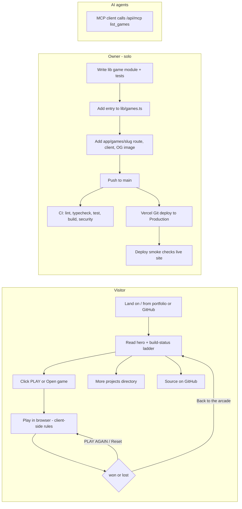
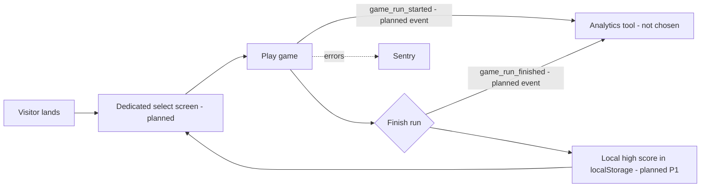

# 01 — Business process (As-Is / To-Be)

Status: **done**. ภาพจากโค้ด `origin/main` `1d9124c` (2026-10-24); live: https://game-collection.bookchaowalit.com

## As-Is (จากโค้ดวันนี้)

Book Arcade เป็น static-first Next.js site: visitor เข้าหน้า home → เลือกเกม → เล่นในเบราว์เซอร์ทั้งหมด (pure rule modules ใน `lib/<game>.ts`)
ไม่มี account, ไม่มี backend data, ไม่มี high score — จบเกมแล้ว state หายเมื่อออกจากหน้า (React `useState` เท่านั้น)
งานฝั่ง owner คือเพิ่มเกมใหม่ทีละเกมผ่าน catalog `lib/games.ts` + route folder ซึ่ง `tests/games.test.ts` บังคับให้ครบ

Sources: `app/page.tsx`, `app/games/*/page.tsx`, `app/games/*/game-client.tsx`, `lib/games.ts`, `lib/roadmap.ts`, `tests/games.test.ts`, `app/api/mcp/route.ts`, `lib/mcp.ts`, `.github/workflows/ci.yml`, `.github/workflows/deploy-smoke.yml`, `README.md`

## To-Be (จาก PRODUCT.md, README, docs/UPGRADE-PLAN.md, docs/measurement/KPI-PLAN.md เท่านั้น)

Sources: `PRODUCT.md` (Status, 60-second goal), `README.md` (Stage 3: select screen + high scores), `docs/UPGRADE-PLAN.md` (P1 high scores in `localStorage`, P2 Playwright smoke), `docs/measurement/KPI-PLAN.md` (events `game_run_started` / `game_run_finished`, KPI-O-01)

## Open questions

- เลือก analytics tool ตัวไหน (KPI-PLAN กำหนดตัดสินใจภายใน 2026-11-15) และ cookieless หรือ consent-gated
- select screen เป็นหน้าแยก (`/games`?) หรือแทนที่ home — ไม่มี spec
- `SITE_URL` (`lib/site.ts`) = `https://bookchaowalit.com` แต่ live host คือ `game-collection.bookchaowalit.com` (UPGRADE-PLAN P0) — To-Be ควรใช้ domain ไหน
