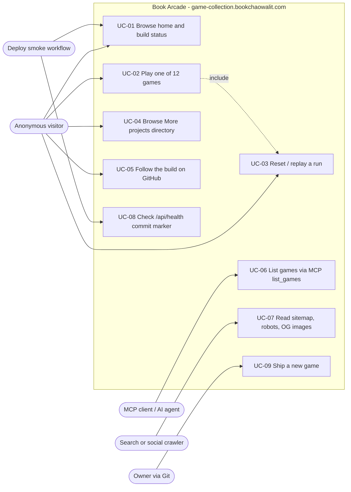

# 02 — Use cases

Status: **done**. ไม่มี auth ในโค้ด (ไม่มี middleware, session, cookie) ดังนั้น actor มีแค่ anonymous visitor, MCP client,
automation (CI / deploy smoke) และ owner (ผ่าน Git เท่านั้น ไม่มี admin UI)

Sources: `app/page.tsx`, `app/games/*/page.tsx`, `app/more-projects/page.tsx`, `app/api/mcp/route.ts`, `lib/mcp.ts`, `app/api/health/route.ts`, `app/sitemap.ts`, `public/robots.txt`, `app/opengraph-image.tsx`, `app/games/*/opengraph-image.tsx`, `scripts/deploy-smoke.sh`, `README.md` (adding a game)

| UC | Actor | Entry point | Notes |
|---|---|---|---|
| UC-01 | Visitor, Smoke | `/` | hero buttons + cards render from `GAMES` |
| UC-02 | Visitor | `/games/<slug>` (12 slugs) | keyboard (4 games มี keydown handler) หรือ click/touch |
| UC-03 | Visitor | reset/play-again button ใน client | ทุก lib module มี `reset*` หรือ `INITIAL_STATE` |
| UC-04 | Visitor | `/more-projects` | link ออกไป `*.vercel.app` ของ sibling apps |
| UC-05 | Visitor | link `github.com/bookchaowalit-game/bookchaowalit-game-collection-frontend` | ชื่อ repo เก่า (ดู Open questions) |
| UC-06 | MCP client | `POST /api/mcp` | `initialize`, `ping`, `tools/list`, `tools/call list_games` |
| UC-07 | Crawler | `/sitemap.xml`, `/robots.txt`, `opengraph-image` | sitemap URL ใช้ `SITE_URL` |
| UC-08 | Deploy smoke | `GET /api/health` | `{status, service, commit}` |
| UC-09 | Owner | `git push` main | ดู 18-git-release-workflow.md |

## Open questions

- ลิงก์ "Source" ชี้ชื่อ repo เก่า `bookchaowalit-game-collection-frontend` — ยัง redirect ไปที่ `games-game-collection-web` หรือไม่ (ไม่ได้ตรวจ)
