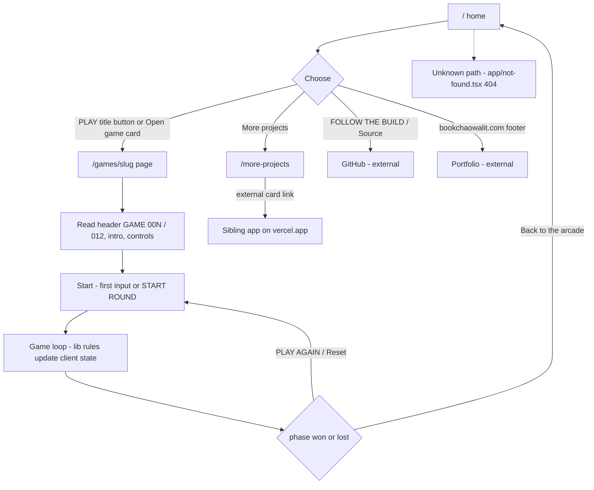
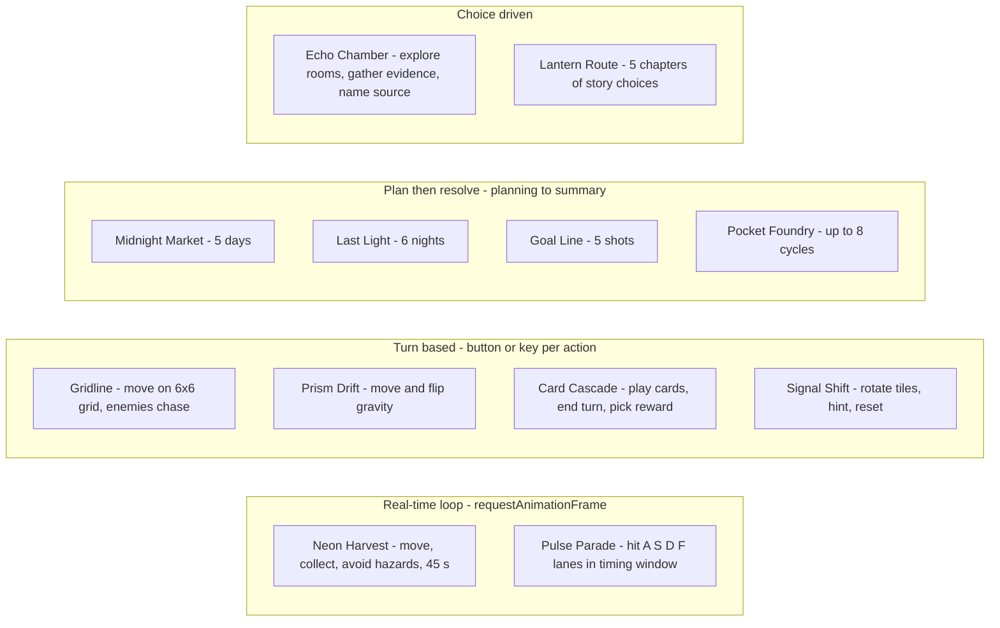

# 03 — User flows

Status: **done**. Role เดียวที่มี UI คือ anonymous visitor; flow มาจาก routes ใน `app/` และ phase ของแต่ละเกม

## Flow A — Landing → play → replay

Sources: `app/page.tsx`, `app/games/card-cascade/page.tsx` (โครงหน้าเหมือนกันทั้ง 12 เกม), `app/games/neon-harvest/game-client.tsx`, `app/more-projects/page.tsx`, `app/not-found.tsx`, `lib/games.ts` (`gameCounterLabel`)

## Flow B — Game interaction styles

Sources: `lib/neon-harvest.ts` (`ROUND_SECONDS = 45`), `lib/pulse-parade.ts` (`LANE_KEYS`), `lib/gridline.ts` (`GRID_SIZE = 6`), `lib/prism-drift.ts`, `lib/card-cascade.ts`, `lib/signal-shift.ts`, `lib/midnight-market.ts`, `lib/last-light.ts` (`NIGHT_COUNT = 6`), `lib/goal-line.ts` (`SHOT_COUNT = 5`), `lib/pocket-foundry.ts` (`CYCLE_LIMIT = 8`), `lib/echo-chamber.ts`, `lib/lantern-route.ts`; keydown handlers ใน `app/games/{gridline,neon-harvest,prism-drift,pulse-parade}/game-client.tsx`

## Open questions

- ไม่มี UI-level test (Playwright เป็น P2 ใน UPGRADE-PLAN) จึงยืนยัน flow ได้จากโค้ดเท่านั้น ไม่ใช่จากการรันจริงใน pack นี้
