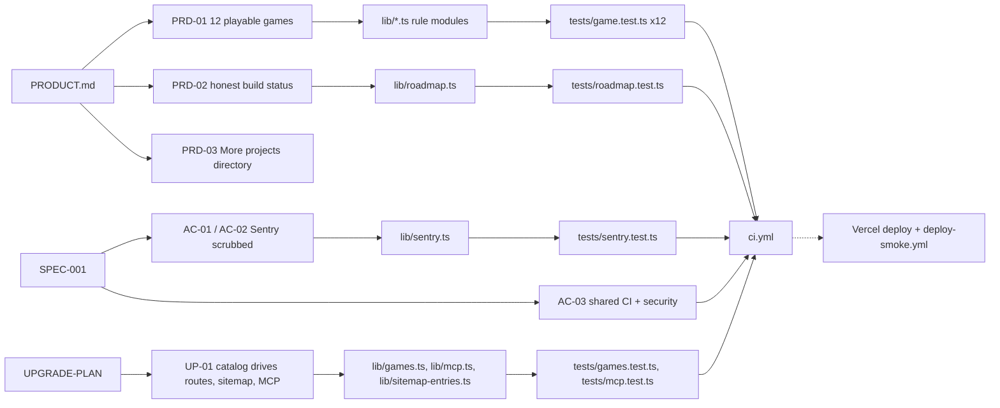

# 04 — Traceability (RTM)

Status: **done**. Requirement มาจาก `PRODUCT.md`, `specs/001-shared-ci-sentry/spec.md`, `docs/UPGRADE-PLAN.md` และ `docs/measurement/KPI-PLAN.md`
ID แบบ `PRD-xx` / `UP-xx` ตั้งขึ้นใน pack นี้เพื่ออ้างอิง (เอกสารต้นทางไม่มี ID) ส่วน `AC-xx` และ `KPI-xx` เป็น ID ของเอกสารต้นทาง
Release: CI = `.github/workflows/ci.yml`, deploy = Vercel Git integration + `.github/workflows/deploy-smoke.yml`

Sources: เอกสารและไฟล์ในตารางด้านล่าง

| Req | Requirement (ย่อ) | Source | Code module | Test | Release / workflow | Gap |
|---|---|---|---|---|---|---|
| PRD-01 | 12 small playable games | PRODUCT.md "Problem", "Real content" | `lib/{neon-harvest,signal-shift,gridline,midnight-market,pulse-parade,card-cascade,last-light,goal-line,echo-chamber,pocket-foundry,lantern-route,prism-drift}.ts`, `app/games/*/game-client.tsx` | `tests/<game>.test.ts` (12 files, rule level) | ci.yml `web` | client components ไม่มี test |
| PRD-02 | สถานะ build ซื่อตรง, ไม่มี "coming soon" ปลอม | PRODUCT.md "What makes it different" | `lib/roadmap.ts`, `app/page.tsx` | `tests/roadmap.test.ts` (ห้าม hard-code count ใน `app/page.tsx`) | ci.yml | — |
| PRD-03 | เก็บ More projects directory | PRODUCT.md | `app/more-projects/page.tsx` | none | — | ไม่มี link check ของ 20+ URL ภายนอก |
| PRD-04 | เล่นเกมได้ภายใน 60 s | PRODUCT.md "60 seconds" | `app/page.tsx` (PLAY buttons) | none | — | วัดไม่ได้จนกว่าจะมี analytics (KPI-L-01) |
| AC-01 | Sentry ปิดเมื่อไม่มี DSN | SPEC-001 | `lib/sentry.ts`, `instrumentation*.ts` | `tests/sentry.test.ts` | ci.yml | — |
| AC-02 | errors only, scrub request/user/extra/locals | SPEC-001 | `lib/sentry.ts` `scrubEvent` | `tests/sentry.test.ts` | ci.yml | — |
| AC-03 | ci-node + security @ `87dc5e1` | SPEC-001 | `.github/workflows/ci.yml` | GitHub Actions run (ทุก run บน main = success) | ci.yml | — |
| AC-04 | เกม render เหมือนเดิม | SPEC-001 | `app/games/*` | manual UI review (ไม่มีไฟล์ test) | — | ไม่มี automated UI test |
| UP-01 | catalog = source of truth (routes, homepage links, header counter, canonical, OG card) | UPGRADE-PLAN pass 1–3 | `lib/games.ts`, `app/games/*/page.tsx` | `tests/games.test.ts` | ci.yml | — |
| UP-02 | sitemap จาก catalog | UPGRADE-PLAN pass 1 | `lib/sitemap-entries.ts`, `app/sitemap.ts` | `tests/games.test.ts` (import `buildSitemapEntries`) | ci.yml | URL ใช้ `bookchaowalit.com` ไม่ใช่ live host (P0) |
| UP-03 | MCP `list_games` จริง + JSON-RPC errors | UPGRADE-PLAN pass 1 | `lib/mcp.ts`, `app/api/mcp/route.ts` | `tests/mcp.test.ts` | ci.yml | route handler (parse error 400 / 202) ไม่มี test |
| UP-04 | health commit marker สำหรับ smoke | deploy-smoke.yml (ADR-0003 D3 ของ owner) | `app/api/health/route.ts` | `tests/health.test.ts` | deploy-smoke.yml | — |
| UP-05 | a11y ของเกม canvas/keyboard | UPGRADE-PLAN P1 | — | — | — | **not built** |
| UP-06 | select screen + local high scores | UPGRADE-PLAN P1, README Stage 3 | — | — | — | **not built** |
| UP-07 | Playwright smoke ทุก game route | UPGRADE-PLAN P2 | — | — | — | **not built** |
| KPI-O-01..G-01 | events `game_run_started` / `game_run_finished` | KPI-PLAN | — | — | — | **planned**, ไม่มีโค้ด |

## Open questions

- requirement ใน PRODUCT.md ยังไม่มี ID ทางการ — ต้องการให้ระบุใน PRODUCT.md หรือ spec ใหม่หรือไม่
