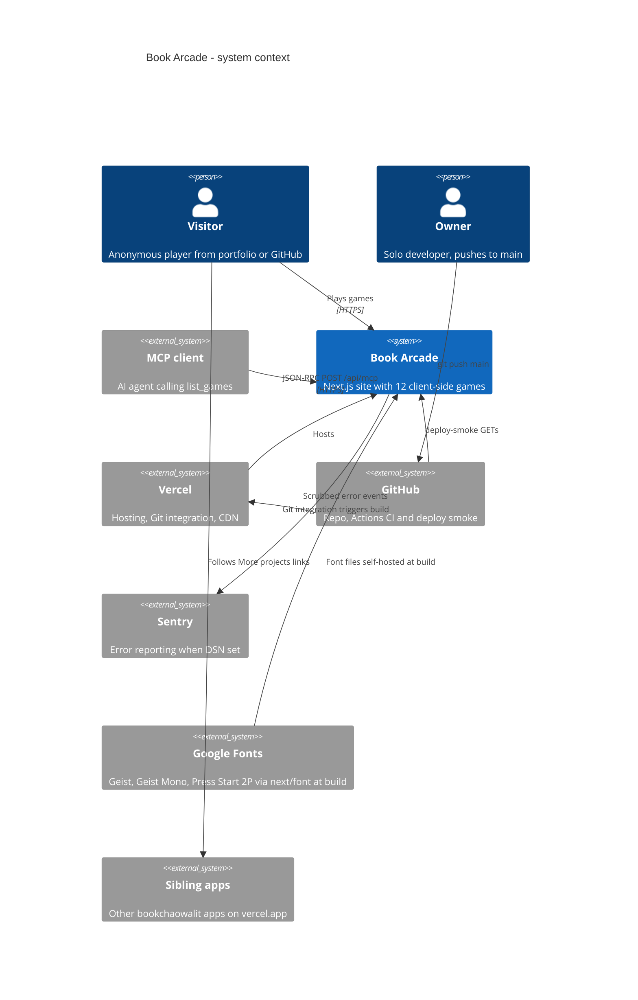

# 05 — C4 Context

Status: **done**

Sources: `app/layout.tsx` (`next/font/google`), `app/api/mcp/route.ts`, `instrumentation.ts`, `instrumentation-client.ts`, `lib/sentry.ts`, `app/more-projects/page.tsx`, `.github/workflows/ci.yml`, `.github/workflows/deploy-smoke.yml`, `specs/001-shared-ci-sentry/spec.md` §4, `vercel inspect` (aliases, 2026-11-03)

## Open questions

- Sentry project ใดรับ event ของ repo นี้ (Vercel มี `NEXT_PUBLIC_SENTRY_DSN` ใน Production — ตรวจจากชื่อตัวแปรเท่านั้น ไม่ได้ดูค่า)
