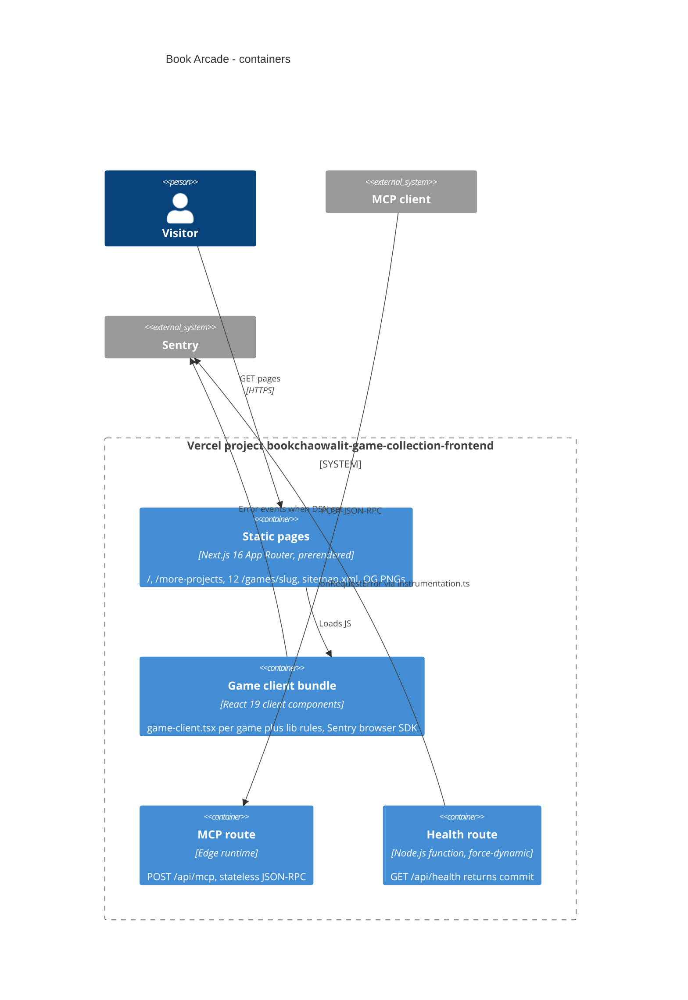

# 06 — C4 Container

Status: **done**. ทุก container อยู่ใน Next.js project เดียวบน Vercel; ไม่มี database หรือ service แยก

Sources: `package.json` (next 16.4.2, react 19.2.3, @sentry/nextjs ^11.8.0), `app/api/mcp/route.ts` (`runtime = "edge"`), `app/api/health/route.ts` (`dynamic = "force-dynamic"`), `instrumentation.ts`, `instrumentation-client.ts`, `app/opengraph-image.tsx`, `app/games/*/opengraph-image.tsx`, `app/sitemap.ts`, UPGRADE-PLAN pass 3 (OG PNGs static at build)

## Open questions

- runtime ของ server-side Sentry ใน Edge route (`/api/mcp`) — `instrumentation.ts` init แบบเดียวกันทุก runtime ไม่ได้แยก `NEXT_RUNTIME`; ยังไม่ยืนยันว่า edge errors ถึง Sentry
