# 07 — C4 Component

Status: **done**. Component ภายใน app (โฟลเดอร์ `app/` + `lib/`)

```mermaid
flowchart TB
  subgraph Pages["app/ - routes"]
    HOME["app/page.tsx - home"]
    LAYOUT["app/layout.tsx - metadata, fonts"]
    GPAGE["app/games/slug/page.tsx x12"]
    GCLIENT["app/games/slug/game-client.tsx x12 - use client"]
    OG["opengraph-image.tsx - root + x12"]
    SITEMAP["app/sitemap.ts"]
    MORE["app/more-projects/page.tsx"]
    NF["app/not-found.tsx"]
    MCPR["app/api/mcp/route.ts"]
    HR["app/api/health/route.ts"]
  end
  subgraph Lib["lib/ - pure modules"]
    GAMES["games.ts - catalog GAMES, gamePath, gameCounterLabel"]
    ROAD["roadmap.ts - STAGES, honestyCopy, liveSummary"]
    RULES["12 rule modules e.g. card-cascade.ts"]
    MCPL["mcp.ts - handleRpc"]
    SME["sitemap-entries.ts"]
    SITE["site.ts - SITE_URL"]
    GOG["game-og.tsx - renderGameOgImage"]
    SEN["sentry.ts - sentryOptions, scrubEvent"]
  end
  INST["instrumentation.ts + instrumentation-client.ts"]

  HOME --> GAMES
  HOME --> ROAD
  ROAD --> GAMES
  GPAGE --> GAMES
  GPAGE --> GCLIENT
  GCLIENT --> RULES
  OG --> GOG --> GAMES
  SITEMAP --> SME --> GAMES
  SITEMAP --> SITE
  LAYOUT --> SITE
  MCPR --> MCPL --> GAMES
  INST --> SEN
```

Sources: import statements ใน `app/page.tsx`, `app/layout.tsx`, `app/games/card-cascade/page.tsx`, `app/games/card-cascade/opengraph-image.tsx`, `app/games/neon-harvest/game-client.tsx`, `app/sitemap.ts`, `app/api/mcp/route.ts`, `lib/roadmap.ts`, `lib/mcp.ts`, `lib/sitemap-entries.ts`, `lib/game-og.tsx`, `instrumentation*.ts`

หมายเหตุ: Neon Harvest client ประกาศ `type Phase` ของตัวเอง (lib ไม่มี phase), Signal Shift ใช้ `isSolved(board)` แทน phase, อีก 10 เกมใช้ `INITIAL_STATE` / `phase` จาก lib module
