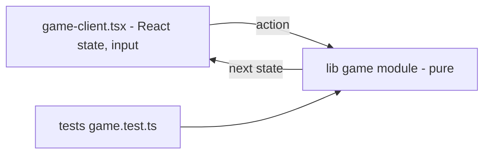

# ADR-0001 — Next.js App Router, static-first, game rules as pure TS modules

- Status: **accepted (retro-documented)** 2026-11-03
- Context: arcade ต้องเพิ่มเกมทีละเกม ทดสอบได้ และ deploy บน Vercel ได้ง่าย

## Decision

ใช้ Next.js 16 App Router + React 19 + Tailwind 4; ทุกหน้าเป็น static route; logic ของเกมอยู่ใน `lib/<game>.ts` เป็น pure function
(state in → state out) ส่วน `app/games/<slug>/game-client.tsx` (`"use client"`) เป็นแค่ UI + input loop
ทดสอบด้วย Node test runner (`node --experimental-strip-types --test`) ไม่ใช้ Jest/Vitest

## Evidence

- `package.json`: `next 16.4.2`, `react 19.2.3`, `tailwindcss ^4`, script `test`
- `lib/card-cascade.ts` ฯลฯ: export `INITIAL_STATE`, transition functions ที่คืน state ใหม่
- `tests/*.test.ts`: import จาก `../lib/<game>.ts` ตรง ๆ, 108 tests pass (รันใน pack นี้ 2026-11-03)
- `docs/UPGRADE-PLAN.md` pass 4: "all state is integer-valued … there is no `Math.random`"

Sources: `package.json`, `lib/*.ts`, `app/games/*/game-client.tsx`, `tests/*.test.ts`, `docs/UPGRADE-PLAN.md`

## Consequences

- เกมเป็น deterministic → unit test ง่าย; ไม่มี server cost
- client UI ไม่มี test (ช่องว่างใน 17-test-coverage-matrix.md)
