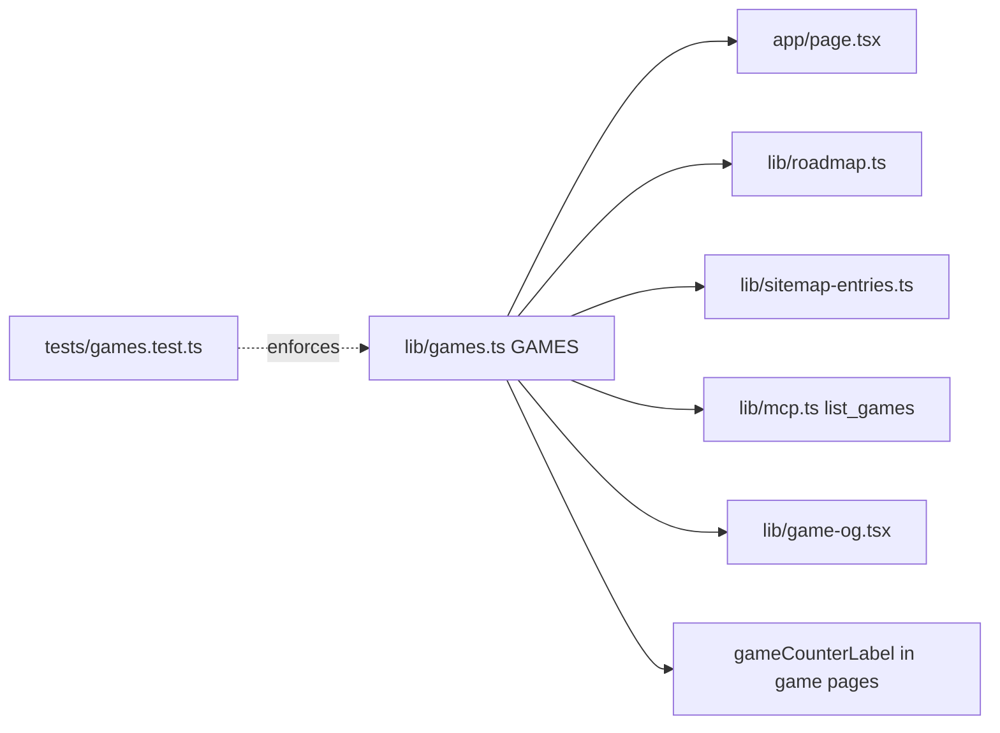

# ADR-0002 — `lib/games.ts` catalog เป็น single source of truth

- Status: **accepted (retro-documented)** 2026-11-03

## Decision

รายชื่อเกม (number, slug, title, summary) อยู่ที่ `lib/games.ts` ที่เดียว; homepage buttons/cards, roadmap copy, sitemap, header counter,
OG card และ MCP `list_games` อ่านจาก catalog; test บังคับให้ route folder ตรงกับ catalog

## Evidence

- `lib/games.ts` comment: "Single source of truth for the shipped games"
- `tests/games.test.ts`: "matches the route folders under app/games exactly", ตรวจ `page.tsx`, `game-client.tsx`, `opengraph-image.tsx` ต่อ slug
- `tests/roadmap.test.ts`: ห้าม hard-code จำนวนเกมใน `app/page.tsx`
- `docs/UPGRADE-PLAN.md` pass 1 และ pass 3

Sources: `lib/games.ts`, `lib/roadmap.ts`, `lib/sitemap-entries.ts`, `lib/mcp.ts`, `lib/game-og.tsx`, `tests/games.test.ts`, `tests/roadmap.test.ts`

## Consequences

- เพิ่มเกม = 1 entry + 3 ไฟล์ใน route folder; test แดงถ้าลืม
- page แต่ละเกมยังเรียก `gameCounterLabel(6)` ด้วยเลข hard-code (ตรวจโดย test)
