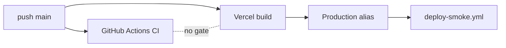

# ADR-0003 — Vercel hosting; CI ไม่ deploy และไม่ gate deploy

- Status: **accepted (retro-documented)** 2026-11-03

## Decision

Production อยู่บน Vercel project `bookchaowalit-game-collection-frontend` (custom domain `game-collection.bookchaowalit.com`)
CI บน GitHub Actions ตรวจอย่างเดียว ("CI never deploys"); deploy เกิดจาก Vercel Git integration (หรือ Vercel CLI ก่อน 2026-10-24)
และ `deploy-smoke.yml` ตรวจ live site หลัง Vercel รายงาน deployment success

## Evidence

- `.github/workflows/ci.yml` comment: "CI never deploys (production is deployed with the Vercel CLI…)"; `permissions: contents: read`
- `.github/workflows/deploy-smoke.yml`: trigger `deployment_status`, environment `Production*`
- GitHub Deployments API: 2026-10-24 `Production` `1d9124c` by `vercel[bot]` (Git integration ทำงานแล้ว); ก่อนหน้านั้น record ล่าสุด 2026-02-28
- `vercel ls` (2026-11-03): production deployments 2026-10-08, 10-13, 10-23, 10-24
- `specs/001-shared-ci-sentry/spec.md` §4: Git link เดิมชี้ repo ก่อน transfer, 10-13 deploy ด้วย CLI
- `gh api …/branches/main/protection` → 404 "Branch not protected"

Sources: `.github/workflows/ci.yml`, `.github/workflows/deploy-smoke.yml`, `scripts/deploy-smoke.sh`, `specs/001-shared-ci-sentry/spec.md`, GitHub Deployments API, `vercel ls` / `vercel inspect`

## Consequences

- commit ที่ CI แดงยังขึ้น production ได้ (ไม่มี branch protection / required checks)
- SPEC-001 §4 "Deployment gap" ล้าสมัยบางส่วน: Git deploy กลับมาแล้ว 2026-10-24
