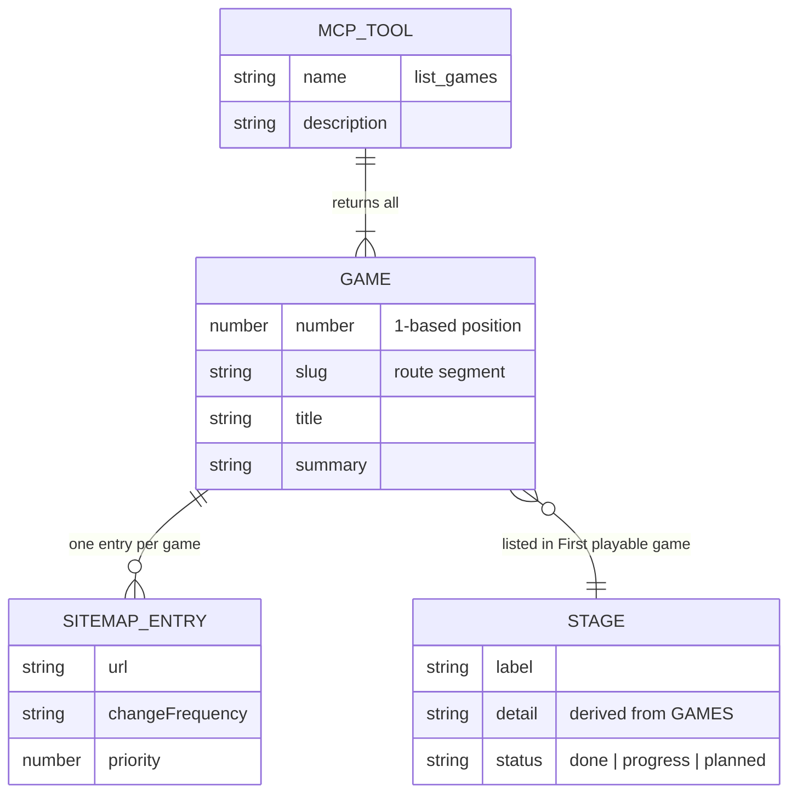

# 09 — ERD

Status: **not_applicable** — ไม่มี persisted data: ไม่มี database, migration, ORM, `localStorage`, cookie หรือ API ที่เขียนข้อมูล
(`grep localStorage|sessionStorage|cookie|fetch(` ใน `app/` และ `lib/` ไม่พบการใช้งาน; `package.json` ไม่มี DB dependency) ดู ADR-0004

## Reference only — static in-code model (ไม่ใช่ข้อมูลที่ persist)

ข้อมูลที่มีอยู่คือค่าคงที่ใน TypeScript ที่ build เข้า bundle; แสดงไว้เพื่อให้เห็นโครง catalog เท่านั้น

Sources: `lib/games.ts` (`type Game`), `lib/roadmap.ts` (`type Stage`), `lib/sitemap-entries.ts` (`type SitemapEntry`), `lib/mcp.ts` (`TOOLS`)

## Open questions

- ถ้าทำ local high scores (UPGRADE-PLAN P1) จะต้องมี schema ของ key ใน `localStorage` — ยังไม่มี spec
