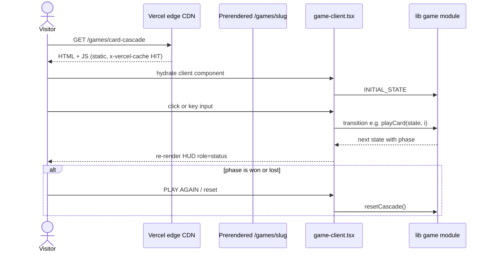
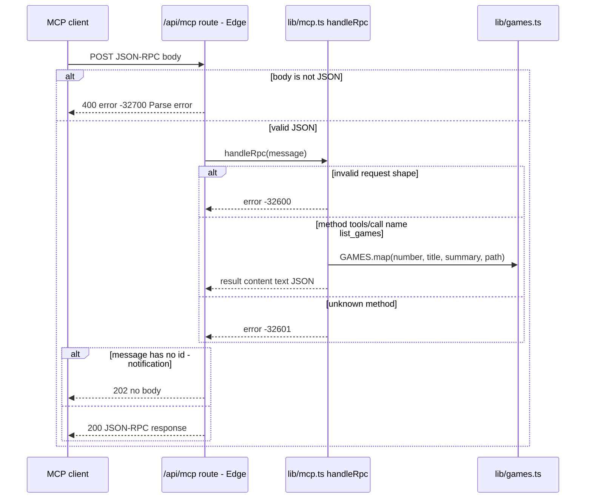
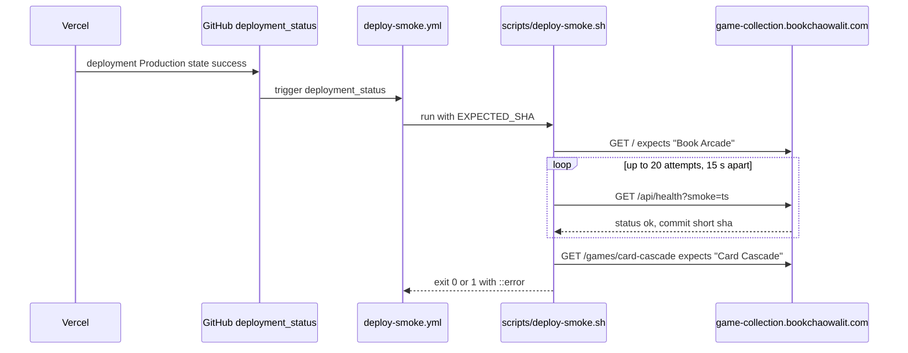
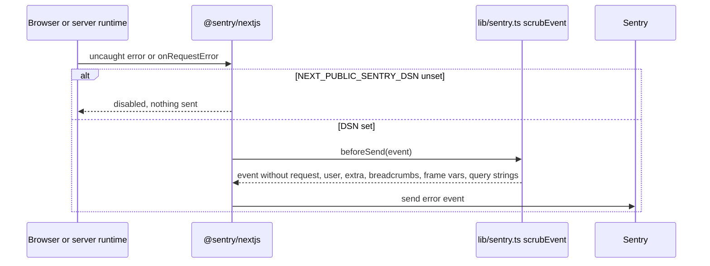

# 10 — Sequences

Status: **done**. 4 request path ที่สำคัญ

## S1 — เปิดหน้าเกมและเล่นหนึ่ง run

Sources: `app/games/card-cascade/page.tsx`, `app/games/card-cascade/game-client.tsx`, `lib/card-cascade.ts`, `curl -I` บน live site (2026-11-03: `server: Vercel`, `x-vercel-cache: HIT`)

## S2 — MCP `tools/call list_games`

Sources: `app/api/mcp/route.ts`, `lib/mcp.ts`, `tests/mcp.test.ts`, live `tools/list` call 2026-11-03

## S3 — Deploy smoke หลัง Vercel deploy

Sources: `.github/workflows/deploy-smoke.yml`, `scripts/deploy-smoke.sh`, `app/api/health/route.ts`

## S4 — Runtime error ไป Sentry

Sources: `instrumentation.ts`, `instrumentation-client.ts`, `lib/sentry.ts`, `tests/sentry.test.ts`
