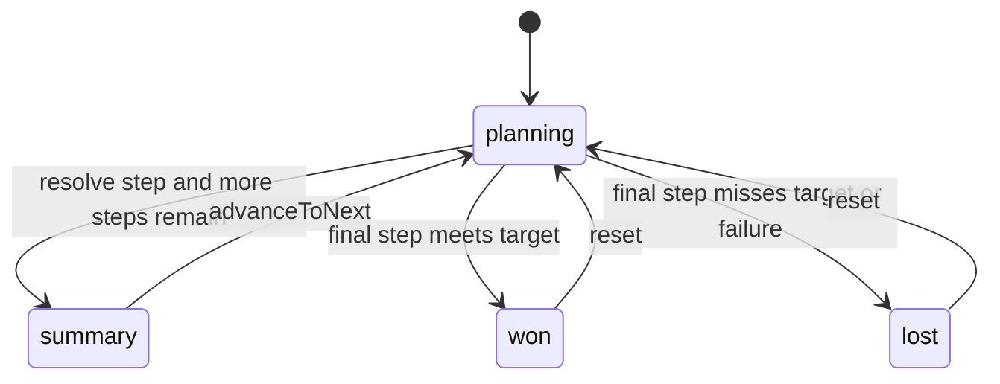
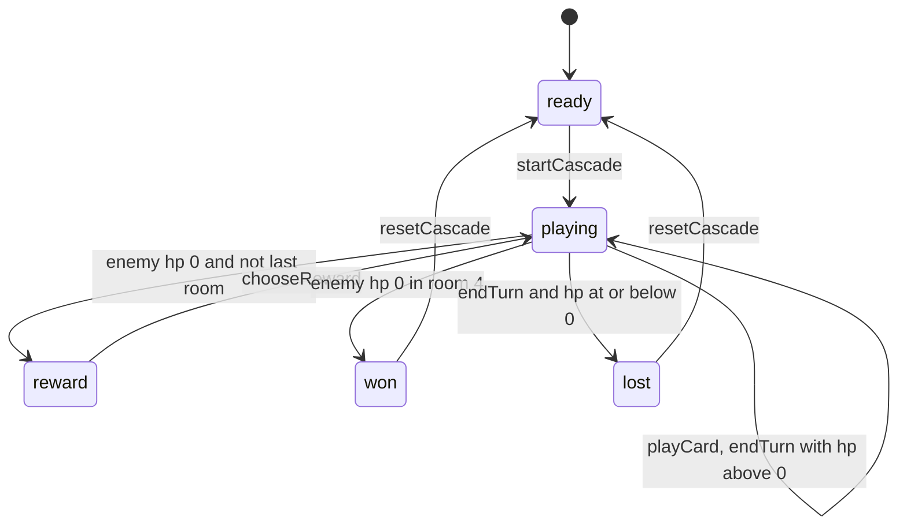
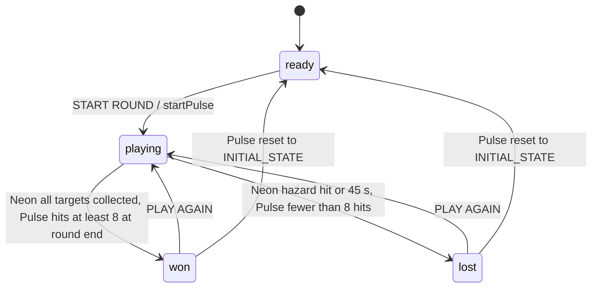
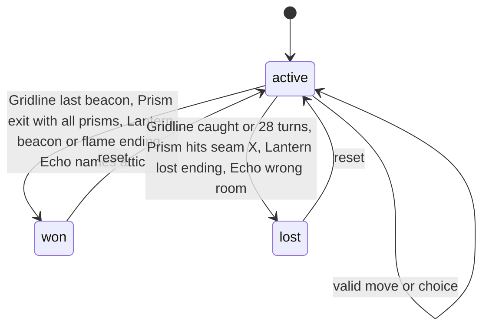
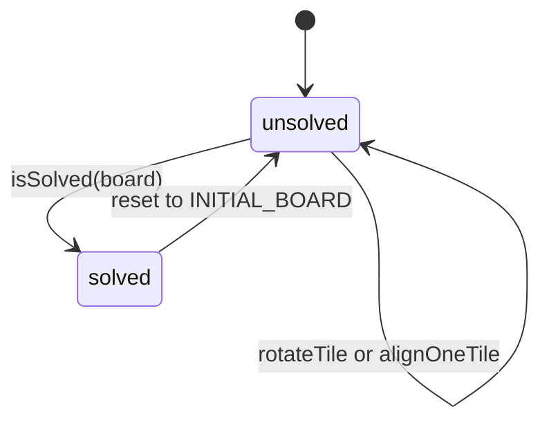
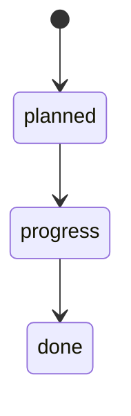

# 11 — State machines

Status: **done**. ทุกเกมมี lifecycle (`phase`) ใน lib หรือ client; ไม่มี entity ที่ persist
ทุกเกมมี reset ที่กลับไปสถานะเริ่มต้น (ไม่วาดซ้ำในทุกภาพ)

## Plan → resolve games (Midnight Market, Last Light, Goal Line, Pocket Foundry)

เงื่อนไขจริง: Midnight Market `openMarket` — หลังวันสุดท้าย `cash >= TARGET_CASH (420)` = won; Last Light `resolveNight` — `health <= 0` = lost, ครบ `NIGHT_COUNT (6)` = won;
Goal Line `takeShot` — ครบ `SHOT_COUNT (5)` แล้ว `goals >= GOAL_TARGET (3)` = won; Pocket Foundry `runCycle` — `shipments >= 3` = won (ได้ก่อน cycle สุดท้าย), `cycle >= CYCLE_LIMIT (8)` = lost

Sources: `lib/midnight-market.ts`, `lib/last-light.ts`, `lib/goal-line.ts`, `lib/pocket-foundry.ts`

## Card Cascade

Sources: `lib/card-cascade.ts` (`CascadePhase`, `ROOM_COUNT = 4`)

## Real-time games (Neon Harvest, Pulse Parade)

Sources: `app/games/pulse-parade/game-client.tsx` (`syncState(INITIAL_STATE)`), `app/games/neon-harvest/game-client.tsx` (`type Phase`, `finishRound`), `lib/neon-harvest.ts` (`ROUND_SECONDS`), `lib/pulse-parade.ts` (`tickPulse`, `TARGET_HITS = 8`, `ROUND_END_MS`)

## Move / choice games (Gridline, Prism Drift, Lantern Route, Echo Chamber)

`active` = `playing` (Gridline, Prism Drift, Lantern Route) หรือ `investigating` (Echo Chamber)

Sources: `lib/gridline.ts` (`advanceTurn`, `MAX_TURNS = 28`), `lib/prism-drift.ts`, `lib/lantern-route.ts` (`chooseStoryChoice`, `LanternEnding`), `lib/echo-chamber.ts` (`nameSource`, `ORIGIN_ROOM = "attic"`)

## Signal Shift (ไม่มี phase field)

Sources: `lib/signal-shift.ts`, `app/games/signal-shift/game-client.tsx`

## Roadmap stage status (ข้อมูลคงที่)

`StageStatus = "done" | "progress" | "planned"` — เปลี่ยนโดยแก้โค้ด ไม่มี runtime transition. Sources: `lib/roadmap.ts`
