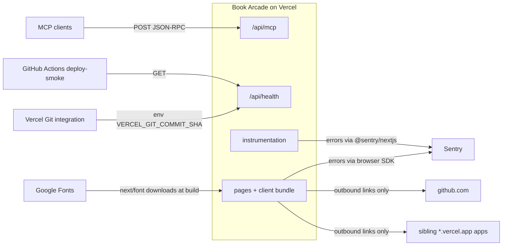

# 12 — API & integrations

Status: **done**

## Endpoints

| Method | Path | Runtime | Request | Response | Test |
|---|---|---|---|---|---|
| POST | `/api/mcp` | Edge | JSON-RPC 2.0: `initialize`, `ping`, `tools/list`, `tools/call {name: list_games}` | 200 JSON-RPC; 400 parse error; 202 for notification | `tests/mcp.test.ts` (handler only) |
| GET | `/api/health` | Node, `force-dynamic` | — | `{status:"ok", service:"games-game-collection-web", commit}` + `cache-control: no-store` | `tests/health.test.ts` |
| GET | `/sitemap.xml` | build | — | home, `/more-projects`, 12 game URLs on `SITE_URL` | `tests/games.test.ts` |
| GET | `/robots.txt` | static file | — | `Allow: /`, `Sitemap: https://bookchaowalit.com/sitemap.xml` | — |
| GET | `/opengraph-image`, `/games/<slug>/opengraph-image` | build | — | 1200x630 PNG | `tests/games.test.ts` (file exists) |

MCP `protocolVersion` = `2024-11-05`, `serverInfo` = `book-arcade 0.1.0`. ไม่มี auth, ไม่มี rate limit ในโค้ด

## External integrations

Sources: `app/api/mcp/route.ts`, `lib/mcp.ts`, `app/api/health/route.ts`, `app/sitemap.ts`, `lib/sitemap-entries.ts`, `public/robots.txt`, `app/opengraph-image.tsx`, `lib/game-og.tsx`, `app/layout.tsx`, `instrumentation*.ts`, `app/more-projects/page.tsx`, `scripts/deploy-smoke.sh`

## Open questions

- MCP endpoint ถูก register ใน registry/connector catalog ใดหรือไม่ (ไม่พบในโค้ด repo นี้)
- `commit` เป็น `null` บน CLI deploy (`VERCEL_GIT_COMMIT_SHA` มีเฉพาะ Git deploy) — smoke ที่รันด้วย `workflow_dispatch` หลัง CLI deploy จะล้ม
