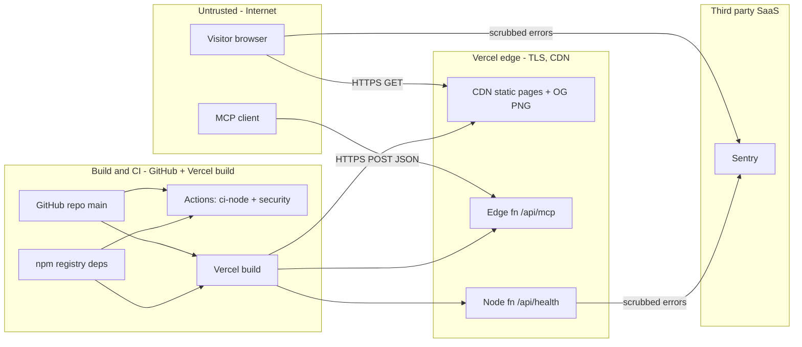

# 13 — Threat model

Status: **done**. ระบบไม่มี auth, ไม่มี persisted data และไม่รับ input ที่ถูกเก็บ — ความเสี่ยงหลักคือ availability, supply chain, deploy integrity และ privacy ของ error events

## DFD with trust boundaries

Sources: `app/api/mcp/route.ts`, `app/api/health/route.ts`, `lib/sentry.ts`, `.github/workflows/ci.yml`, `.github/workflows/deploy-smoke.yml`, `osv-scanner.toml`, `next.config.ts`, `curl -I` บน live site 2026-11-03

## STRIDE per element

| Element | S | T | R | I | D | E | Existing mitigation (in code / config) | Gap |
|---|---|---|---|---|---|---|---|---|
| Static pages (CDN) | – | content tamper via repo/build | – | – | DDoS | – | Vercel TLS + HSTS `max-age=63072000` (live header); content only from repo | ไม่มี CSP / X-Frame-Options / security headers ใน `next.config.ts` (ว่าง) |
| `/api/mcp` (Edge) | anyone can call (no auth by design) | malformed JSON | no request log in code | returns public catalog only | request flood, large body | – | parse error → 400; strict JSON-RPC validation; read-only, no side effects (`lib/mcp.ts`) | ไม่มี rate limit / body size limit ในโค้ด (ขึ้นกับ Vercel platform) |
| `/api/health` | – | – | – | leaks short commit SHA (public repo anyway) | flood → function invocations | – | no I/O, `no-store` | — |
| Game client bundle | – | user can modify own state (single player, no scores stored) | – | – | – | – | no persistence, no server trust in client state (ADR-0004) | — |
| Sentry events | – | – | – | PII in error events | – | – | `sendDefaultPii: false`, `scrubEvent` drops request/user/extra/breadcrumbs/vars/query strings; tests in `tests/sentry.test.ts` | ข้อความ error ที่ developer เขียนเองยังส่งได้ (ไม่มี free-text scrub นอกจาก URL query) |
| GitHub repo / main | push by compromised account | direct push, no review | git history | secrets in repo | – | workflow abuse | `.env*` ใน `.gitignore`; gitleaks + semgrep + osv + trivy ใน `security.yml`; workflows `permissions: contents: read`; actions pinned by SHA; `persist-credentials: false` in smoke | **main ไม่มี branch protection** (API 404); CI ไม่ gate deploy |
| npm dependencies | typosquat | malicious update | – | – | – | – | `package-lock.json`; osv-scanner with reviewed ignore (braces, expires 2027-01-17); Next bumped for GHSA (commits `6d65f00`, `e02b96e`) | ไม่พบ Dependabot/Renovate config ใน repo |
| Vercel build / env | – | – | – | DSN exposure | – | – | DSN เป็น `NEXT_PUBLIC_*` (public by nature, ingest-only) | — |
| Outbound links (`/more-projects`) | link to look-alike domain if sibling project deleted and name reclaimed | – | – | – | – | – | `rel="noopener noreferrer"` | ไม่มี automated link check ของ `*.vercel.app` URLs |

## Open questions

- ต้องการ security headers (CSP, frame-ancestors) หรือไม่ — ไม่มี decision record
- ต้องการ branch protection / required checks บน `main` หรือไม่ (ADR-0003 consequence)
