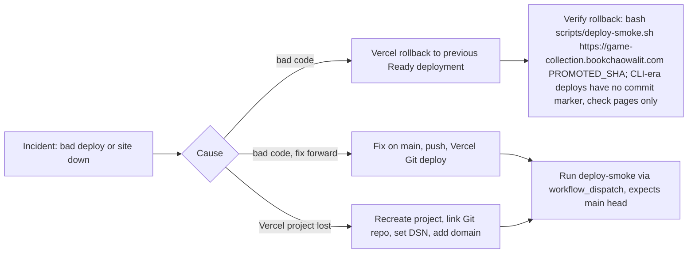

# 14 — Backup & DR

Status: **done** (ไม่มี data ให้ backup — DR = redeploy จาก Git)

## Data inventory

| Data | Where it lives | Backup reality | Restore |
|---|---|---|---|
| Source code, catalog, game rules | GitHub `bookchaowalit-game/games-game-collection-web` (public) + local clones | Git history (distributed copies); ไม่มี backup workflow เฉพาะ | clone + redeploy |
| Build output | Vercel deployments (immutable, 4 production deploys ใน 90 วัน) | Vercel เก็บ deployment เก่า | Vercel "promote/rollback" deployment เดิม |
| Env var `NEXT_PUBLIC_SENTRY_DSN` | Vercel project env (Production) | ไม่พบใน repo ว่าเก็บสำรองที่ใด | ตั้งค่าใหม่จาก Sentry project |
| Error events | Sentry (SaaS) | ตาม retention ของ Sentry plan | n/a |
| User data | **ไม่มี** (ADR-0004) | — | — |

หมายเหตุ: `deploy-smoke.yml` ตั้ง `EXPECTED_SHA` เป็น `github.event.deployment.sha || github.sha` — ถ้า dispatch เองหลัง rollback จะคาดหวัง head ของ main และ fail แม้ rollback สำเร็จ จึงต้องรัน script ตรงพร้อม SHA ของ deployment ที่ promote

Sources: `RUNBOOK.md` (Rollback: "Redeploy previous container image / previous git tag" — generic stub), `.github/workflows/deploy-smoke.yml` (`workflow_dispatch`), `specs/001-shared-ci-sentry/spec.md` §3–4, `vercel ls` / `vercel env ls` (names only) 2026-11-03

## RTO / RPO

- RTO: **not defined** (RUNBOOK.md เป็น stub; "Not proof of production uptime")
- RPO: **not defined** — ไม่มี data ที่สร้างขึ้นตอน runtime; source RPO = commit ล่าสุดที่ push

## Open questions

- RUNBOOK.md ยังเป็น template ทั่วไป (กล่าวถึง Docker / DB ที่ repo นี้ไม่มี) — ควรเขียนใหม่ให้ตรง Vercel
- ไม่มี Git tag / release ให้ rollback ตามที่ RUNBOOK เขียน (`git tag` ว่าง) — ใช้ Vercel deployment แทน?
