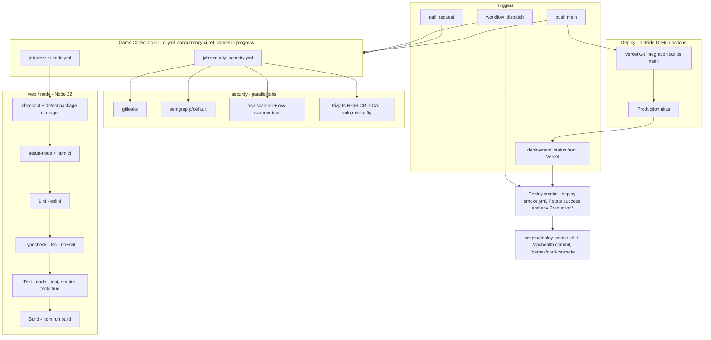

# 15 — CI/CD pipeline

Status: **done**. 2 workflows ใน repo + 2 reusable workflows จาก `bookchaowalit/platform-ci-workflows` @ `87dc5e1` (v1.1.1); runner = GitHub-hosted `ubuntu-24.04` (public repo)

Sources: `.github/workflows/ci.yml`, `.github/workflows/deploy-smoke.yml`, `scripts/deploy-smoke.sh`, `platform-ci-workflows/.github/workflows/ci-node.yml@87dc5e1` และ `security.yml@87dc5e1` (อ่านผ่าน GitHub API 2026-11-03), job names จาก `gh run view` ของ run ล่าสุด (`web / node (.)`, `security / gitleaks|semgrep|osv-scanner|trivy-fs`)

## Run history (ทั้งหมดที่ GitHub เก็บ, 2026-11-03)

- `Game Collection CI`: 12 runs บน push main ตั้งแต่ 2026-08-11 ถึง 2026-10-24 — ทั้งหมด `success`
- `Deploy smoke`: 1 run (2026-10-24 `1d9124c`, `deployment_status`) — `success`

Sources: `gh run list -R bookchaowalit-game/games-game-collection-web -L 100`

## Open questions

- ไม่มี coverage gate (`coverage-threshold` ไม่ได้ตั้ง; test runner เป็น node --test ไม่ใช่ vitest/jest จึงใช้ gate ของ ci-node ไม่ได้ตรง ๆ)
