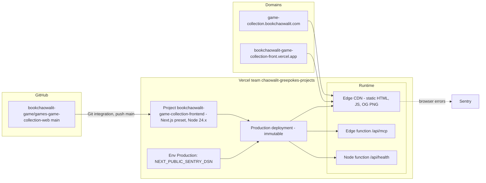

# 16 — Deployment

Status: **done**

Sources: `vercel project inspect` / `vercel inspect` / `vercel env ls` (names only) 2026-11-03, `app/api/mcp/route.ts`, `app/api/health/route.ts`, `specs/001-shared-ci-sentry/spec.md` §4, `.github/workflows/deploy-smoke.yml`

| Item | Value | Evidence |
|---|---|---|
| Current production | `1d9124c` | live `GET /api/health` → `{"commit":"1d9124c"}` (2026-11-03) |
| Production deployments, 90 d | 2026-10-08, 10-13, 10-23, 10-24 (ทั้งหมด Ready) | `vercel ls` |
| Git-integration deploys | 2026-10-24 `1d9124c` (`vercel[bot]`) | GitHub Deployments API |
| Data stores | none | ADR-0004 |
| Edge PoP เห็นจาก Bangkok | `sin1` | `x-vercel-id` header |

## Open questions

- `SITE_URL` / `robots.txt` / sitemap ใช้ `https://bookchaowalit.com` ขณะที่ live host คือ `game-collection.bookchaowalit.com` — sitemap.xml live ชี้ URL `bookchaowalit.com/games/...` (UPGRADE-PLAN P0, ยังไม่ปิด)
- ไม่มี Preview environment env vars (DSN ตั้งเฉพาะ Production) — ตั้งใจหรือไม่
