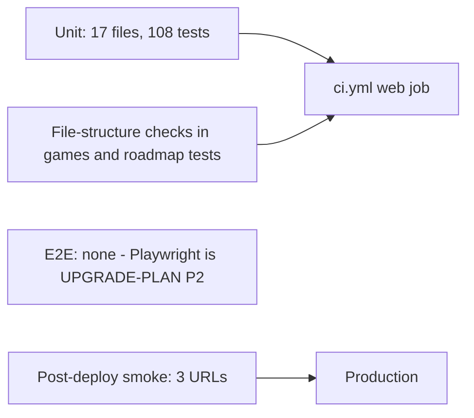

# 17 — Test coverage matrix

Status: **done**. Test runner: `node --experimental-strip-types --test tests/**/*.test.ts` — 108 tests / 22 suites pass (รันใน worktree 2026-11-03)
ไม่มี integration หรือ e2e test ใน repo; coverage % ไม่ได้วัด

| Feature | Unit (lib) | Integration (route / file-structure) | E2E / UI | Test file(s) |
|---|---|---|---|---|
| Neon Harvest rules | yes (4) | – | **gap** | `tests/neon-harvest.test.ts` |
| Signal Shift rules | yes (5) | – | **gap** | `tests/signal-shift.test.ts` |
| Gridline rules | yes (6) | – | **gap** | `tests/gridline.test.ts` |
| Midnight Market rules | yes (5) | – | **gap** | `tests/midnight-market.test.ts` |
| Pulse Parade rules | yes (6) | – | **gap** | `tests/pulse-parade.test.ts` |
| Card Cascade rules | yes (7) | – | **gap** | `tests/card-cascade.test.ts` |
| Last Light rules | yes (8) | – | **gap** | `tests/last-light.test.ts` |
| Goal Line rules | yes (7) | – | **gap** | `tests/goal-line.test.ts` |
| Echo Chamber rules | yes (8) | – | **gap** | `tests/echo-chamber.test.ts` |
| Pocket Foundry rules | yes (8) | – | **gap** | `tests/pocket-foundry.test.ts` |
| Lantern Route rules | yes (7) | – | **gap** | `tests/lantern-route.test.ts` |
| Prism Drift rules | yes (6) | – | **gap** | `tests/prism-drift.test.ts` |
| Game clients (`game-client.tsx` x12) | **gap** | – | **gap** | — |
| Catalog ↔ routes, homepage links, canonicals, OG files, layout images | – | yes (file-structure checks, 9) | – | `tests/games.test.ts` |
| Sitemap | – | yes (in games.test) | – | `tests/games.test.ts` |
| Roadmap / honesty copy | yes (6) | reads `app/page.tsx` | – | `tests/roadmap.test.ts` |
| MCP handler | yes (7) | **gap** (route: 400 / 202) | – | `tests/mcp.test.ts` |
| Health route | yes (3, calls `GET`) | – | live smoke | `tests/health.test.ts`, `scripts/deploy-smoke.sh` |
| Sentry options + scrub | yes (6) | – | – | `tests/sentry.test.ts` |
| More projects page | **gap** | – | **gap** | — |
| Production site up | – | – | yes (post-deploy smoke: `/`, `/api/health`, `/games/card-cascade`) | `scripts/deploy-smoke.sh` |

ตัวเลขในวงเล็บ = จำนวน `it(`/`test(` ในไฟล์

Sources: `package.json` (`test` script), `tests/*.test.ts`, `scripts/deploy-smoke.sh`, `.github/workflows/ci.yml`, `docs/UPGRADE-PLAN.md` (P2)
