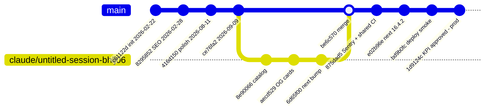
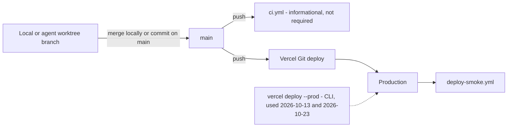

# 18 — Git & release workflow

Status: **done**. Trunk-based: commit ตรงบน `main`; มี merge ครั้งเดียว (`be6c570` จาก `claude/untitled-session-bhlj06`, 2026-10-01); ไม่มี tag/release; main ไม่มี branch protection

Sources: `git log origin/main` (26 commits), `git branch -r`, `git tag` (empty), `gh api …/branches/main/protection` (404 not protected), `.github/workflows/*.yml`, `specs/001-shared-ci-sentry/spec.md` §4, `vercel ls`

หมายเหตุ: gitGraph แสดงเฉพาะ commit เด่น ไม่ใช่ทุก commit; ลำดับ commit บน branch ตาม `git log` (บาง commit อื่นไม่ได้แสดง)

## Open questions

- deploy 2026-10-23 ไม่มี GitHub deployment record → น่าจะเป็น CLI deploy แต่ไม่ทราบ commit ที่ deploy
- PR flow (`pull_request` trigger) มีใน ci.yml แต่ยังไม่เคยมี PR run ใน history
