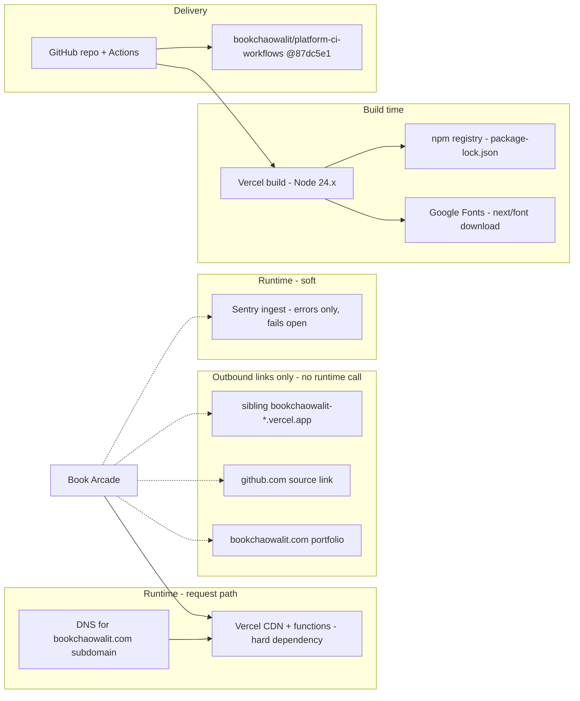

# 19 — Service dependency map

Status: **done**. Runtime dependency น้อยมาก: ไม่มี DB, ไม่มี API ภายนอกที่ถูกเรียกตอน request

Sources: `package.json`, `package-lock.json`, `app/layout.tsx` (`next/font/google`), `lib/sentry.ts`, `instrumentation*.ts`, `.github/workflows/ci.yml`, `app/more-projects/page.tsx`, `app/page.tsx`, `vercel project inspect`

## Open questions

- DNS ของ `bookchaowalit.com` อยู่ที่ provider ใด (Cloudflare?) — ไม่มีหลักฐานใน repo
