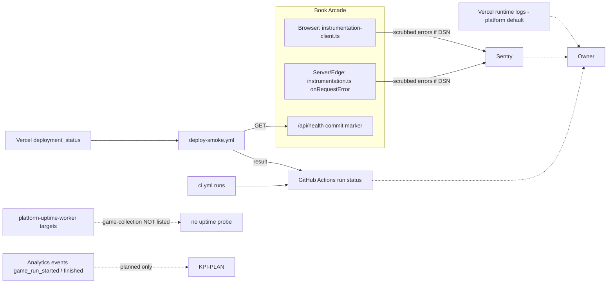

# 20 — Observability

Status: **done**. Signal จริงที่พบ: Sentry errors, post-deploy smoke, CI results. **ไม่มี** analytics, uptime monitor หรือ log pipeline เฉพาะ

Sources: `instrumentation.ts`, `instrumentation-client.ts`, `lib/sentry.ts`, `app/api/health/route.ts`, `.github/workflows/deploy-smoke.yml`, `.github/workflows/ci.yml`, `docs/measurement/KPI-PLAN.md`, `platform-uptime-worker/src/targets.ts` (grep "game" → no match, commit `a26e7dc` 2026-11-03)

| Signal | Watched by | Alert path | Status |
|---|---|---|---|
| Client/server errors | Sentry | ตาม alert rule ใน Sentry (ไม่มีใน repo) | live เมื่อ DSN ตั้ง (Production มี) |
| Deploy correctness | deploy-smoke.yml | GitHub Actions failure notification | live (1 run, success) |
| CI health | ci.yml | GitHub notification | live |
| Uptime | — | — | **gap**: ไม่อยู่ใน uptime worker targets |
| Product KPIs (KPI-O-01, L-01, L-02, G-01) | — | — | **planned**, ไม่มี event code |

## Open questions

- Sentry project / alert rule ของ repo นี้คืออะไร และส่งไปช่องทางไหน
- จะเพิ่ม `https://game-collection.bookchaowalit.com/api/health` เข้า uptime worker หรือไม่
