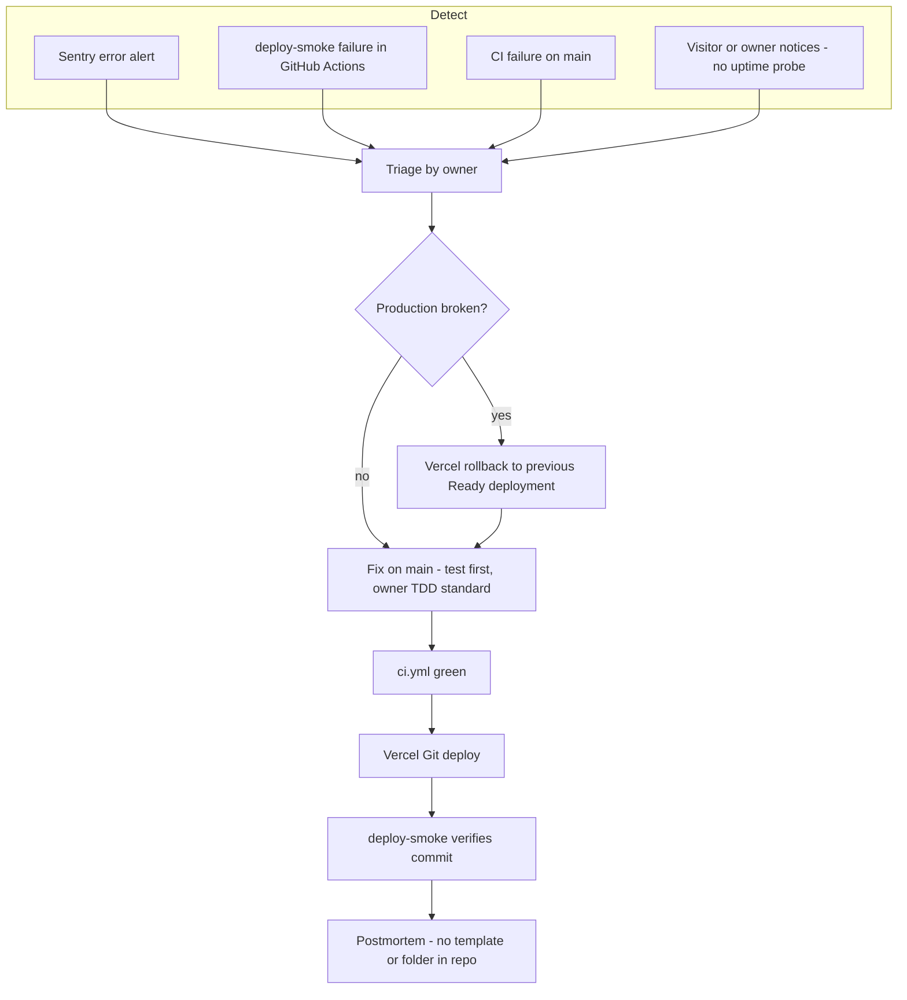

# 21 — Incident response

Status: **done** (flow จาก channel จริงที่มี; ไม่มี on-call — owner คนเดียวตาม RUNBOOK.md)

Sources: `RUNBOOK.md` (Owner: "Solo operator … No multi-person on-call"; Rollback section), `.github/workflows/deploy-smoke.yml`, `.github/workflows/ci.yml`, `lib/sentry.ts`, `specs/README.md` (owner ADR-0004 TDD + SDD in architecture-docs, not 08-adr/ADR-0004 here), 20-observability.md

## Open questions

- Sentry alert ส่งไปที่ใด (email / Telegram)? ไม่มี config ใน repo
- postmortem เก็บที่ไหน — repo นี้ไม่มี `docs/incidents/` หรือ template
- severity levels / ระยะเวลาตอบสนองยังไม่ได้กำหนด
