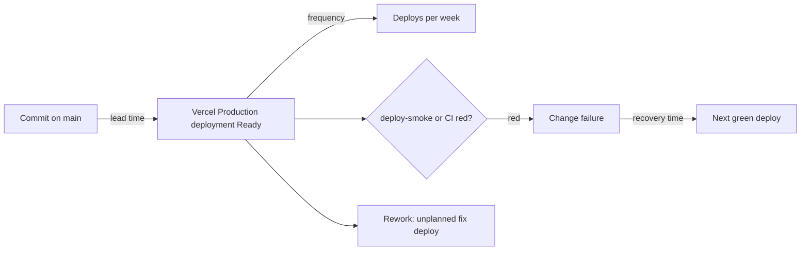

# 22 — DORA metrics

Status: **done** (3 ค่าคำนวณได้ด้วย sample เล็ก, 2 ค่าคำนวณไม่ได้). Window: 90 วันถึง 2026-11-03 (since 2026-08-05)
Deploy = Vercel Production deployment (`vercel ls`) เพราะก่อน 2026-10-24 deploy ด้วย Vercel CLI ซึ่งไม่สร้าง GitHub Deployment



Sources: `.github/workflows/deploy-smoke.yml`, `.github/workflows/ci.yml`, `vercel ls`, GitHub Deployments / Actions API, `git log`

## Results

| Metric | วิธีวัดใน repo นี้ | ค่า 90 วัน | หมายเหตุ |
|---|---|---|---|
| Deployment frequency | จำนวน Production deployments ใน `vercel ls` | **4 deploys** (2026-10-08, 10-13, 10-23, 10-24) ≈ **0.31 / week**; ส.ค.–ก.ย. 0 | มีเพียง 1 deploy (10-24) ที่ผ่าน Git integration |
| Lead time for changes | committer time ของ SHA → GitHub deployment status `success` | **2.9 min** (n = 1: `1d9124c` 09:58:15Z → 10:01:08Z) | CLI deploys 3 ครั้งไม่มี SHA ผูกไว้ → วัดไม่ได้; sample เล็กเกินจะสรุป |
| Change fail rate | (a) deploy-smoke failure / smoke-checked deploys; (b) CI failure บน main | (a) **0 / 1** smoke-checked deploy; ทั้ง window **unknown** (3 deploys ไม่ถูกตรวจ); (b) CI บน main 0 / 12 runs fail — ไม่ใช่ผล production เพราะ CI ไม่ gate deploy | smoke เพิ่ง active 2026-10-24; deploy 3 ครั้งก่อนหน้าไม่ถูก smoke |
| Failed deployment recovery time | เวลาจาก failure ถึง green ถัดไป | **cannot compute** — ไม่มี failure ใน window | ไม่มี incident record |
| Deployment rework rate | deploy ที่ทำเพื่อแก้ปัญหาที่ผู้ใช้เห็น | **cannot compute** — CLI deploys ไม่ผูก SHA; proxy ระดับ commit: subject ขึ้นต้น `fix`/`revert`/`hotfix` = **3 / 21 commits (14%)**, revert = 0 | ทั้ง 3 fix เป็น security/privacy fix ที่วางแผน (Next GHSA, Sentry scrub) ไม่ใช่ incident |

## Commands

```bash
R=bookchaowalit-game/games-game-collection-web
SINCE=2026-08-05

# Deployment frequency (Vercel is the source of truth here)
vercel ls bookchaowalit-game-collection-frontend          # Age / Environment / Status columns
vercel inspect <deployment-url> | grep -E 'target|created' # exact timestamps

# Git-integration deployments + status time (lead time)
gh api "repos/$R/deployments" --jq '.[] | [.id,.environment,.sha[0:7],.created_at] | @tsv'
gh api "repos/$R/deployments/<id>/statuses" --jq '.[] | [.state,.created_at] | @tsv'
git show -s --format=%cI 1d9124c

# Change fail rate
gh run list -R $R -L 100 --json workflowName,event,headBranch,conclusion,createdAt \
  --jq '.[] | select(.createdAt >= "'$SINCE'") | [.workflowName,.headBranch,.conclusion] | @tsv' | sort | uniq -c

# Rework proxy
git log --since=$SINCE --format=%s origin/main | wc -l
git log --since=$SINCE --format=%s origin/main | grep -ciE '^(fix|revert|hotfix)'
```

## Open questions

- deploy 2026-10-08, 10-13, 10-23 (CLI) deploy commit ใด — ต้องดูจาก Vercel dashboard / `vercel inspect --logs`
- ควรนับ CI ที่ไม่ gate deploy เป็น change failure หรือไม่ (ตอนนี้ไม่มี failure จึงยังไม่กระทบ)
